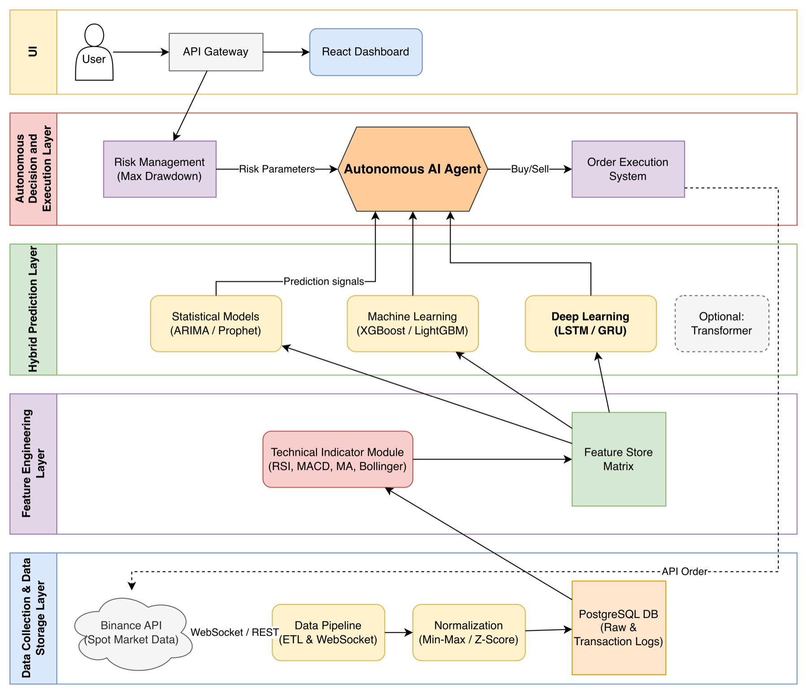

*Experimental Analysis and Development of Hybrid AI Approaches.* This was our graduation project, supported by the TÜBİTAK 2209-A research program. I led a team of three, with Kenan Koçoğlu and Mehmet Enes Odabaş.

Crypto spot markets are volatile and noisy. Investors face a lot of information and often make emotional decisions. We wanted to see how far a systematic pipeline could go. That pipeline ingests market data, builds features, compares forecasting models, turns their signals into decisions with an LLM agent, and puts a hard risk gate in front of every order.

The result is a working end-to-end prototype for BTCUSDT. It is not a profitable trading system, and it was never meant to be used with real money.

## Data and features

The system pulls 1-minute BTCUSDT OHLCV candles from Binance, covering May 2021 to June 2026. Large backfills come from Binance's public monthly data dumps, and recent gaps are filled through REST. Coverage tables record what is already stored, so repeated runs skip data that is already there.

Technical indicators such as RSI, MACD, moving averages, and Bollinger Bands are computed from the raw candles and stored in PostgreSQL as feature rows.

## Comparing models

We compared six model families with walk-forward evaluation and holdout tests. Splitting by time keeps future data out of training.

| Model | Family | Directional accuracy |
|---|---|---:|
| ARIMA | Statistical | 75.00% |
| Prophet | Statistical | 72.73% |
| LSTM | Deep learning | 53.92% |
| LightGBM | Tabular ML | 52.64% |
| XGBoost | Tabular ML | 52.35% |
| GRU | Deep learning | 50.68% |

The statistical models were clearly better at predicting direction. The ML and deep learning models stayed around 50–54%. We also learned that higher accuracy did not mean higher portfolio returns, and none of the model-based strategies beat buy & hold.

## The decision agent

On each closed candle, the live loop backfills missing data, recomputes indicators, settles matured predictions, and runs every active model. It then makes one LLM call. The prompt contains the current price, recent candles, indicators, model predictions, portfolio balances, and the risk limits.

The LLM's answer is never executed directly. Every decision passes a separate risk layer first, which enforces maximum trade and position size, a daily realized-loss limit, maximum orders per day, an order cooldown, exposure limits, and an emergency stop. Decisions, prompts, raw responses, and orders are all written to journals, so every action can be audited later.

## Spot Demo results

We ran the full loop on Binance Spot Demo, which uses no real money. Across 100 consecutive BTCUSDT decisions, the agent chose to hold 92 times and to buy 8 times. Five buys were filled. The risk layer rejected the other three because they would have exceeded the maximum position size. Average LLM latency was 8.4 seconds, which fits inside a 1-minute cycle.

The agent mostly held when model signals conflicted. That was the cautious behavior we wanted, and the run showed that the risk gate works in the real decision flow.

## Dashboard

A FastAPI backend with more than 30 endpoints drives a React dashboard with six tabs:

- **Overview:** price and indicator charts, buy, sell, and hold markers, and position and risk status.
- **Trade:** the Spot Demo portfolio and confirmed manual orders.
- **Agent:** runtime settings, risk limits, and the controls for the live loop.
- **Data:** ingestion, coverage, and gap repair.
- **Models:** training jobs and the model registry.
- **Journal:** decisions, predictions, orders, and the prompt behind each decision.

## Limitations

Model accuracy was too low for reliable short-term direction forecasting. Multi-coin support and long unattended runs were out of scope. Natural next steps would be news and social sentiment signals, Transformer-based models, and support for other markets.

## Stack

Python, uv, PostgreSQL, SQLAlchemy, statsmodels, Prophet, XGBoost, LightGBM, PyTorch, Backtrader, FastAPI, React, Vite, Chart.js, Binance API, OpenRouter.

## Links

- [Source code on GitHub](https://github.com/AhmetServet/crypto-autonomous-portfolio-management)
