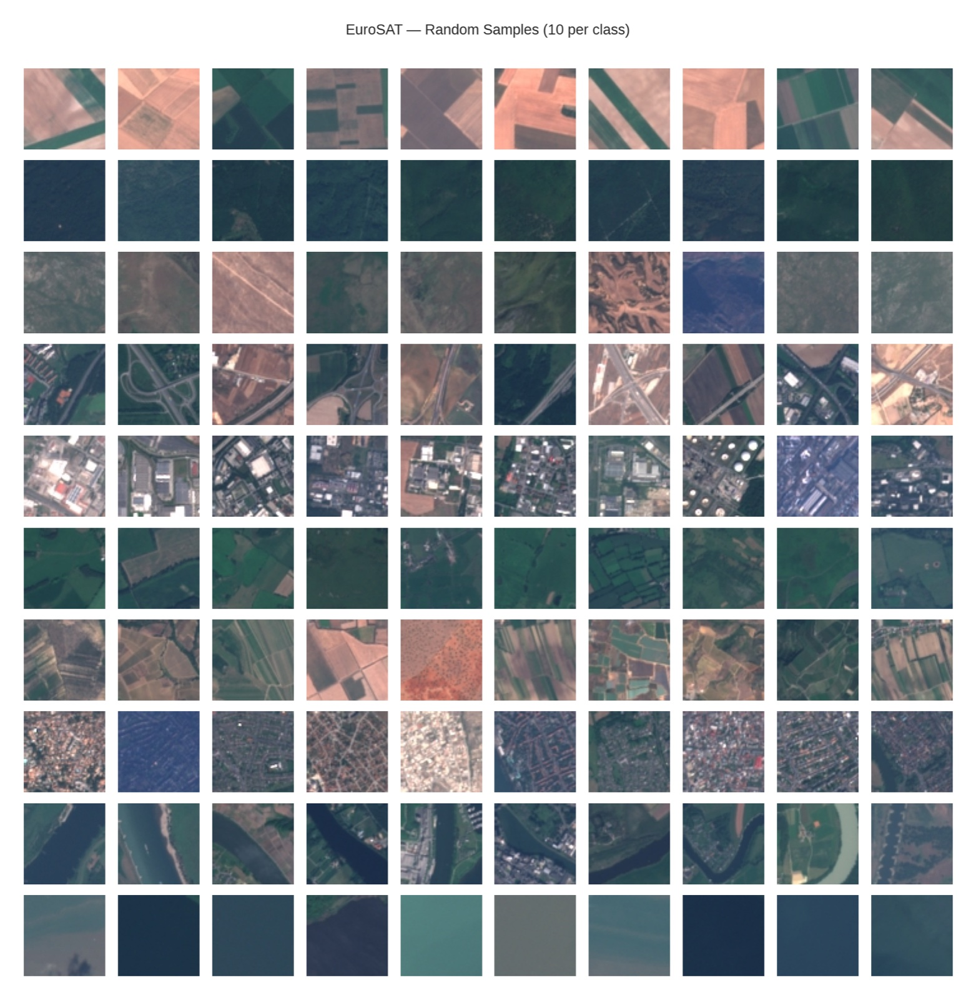
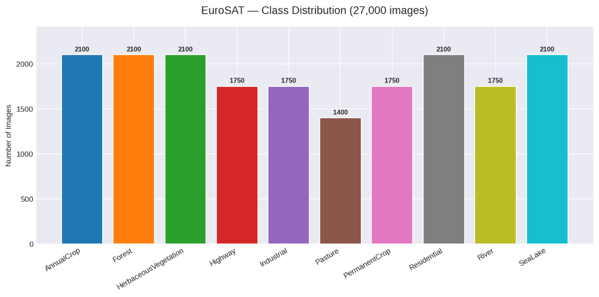
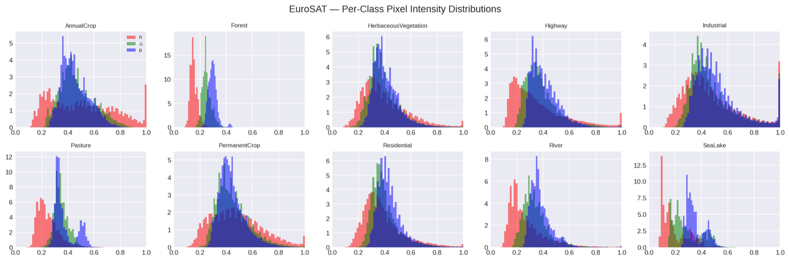
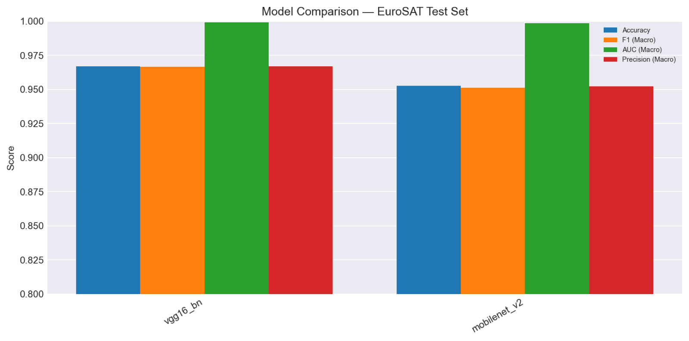
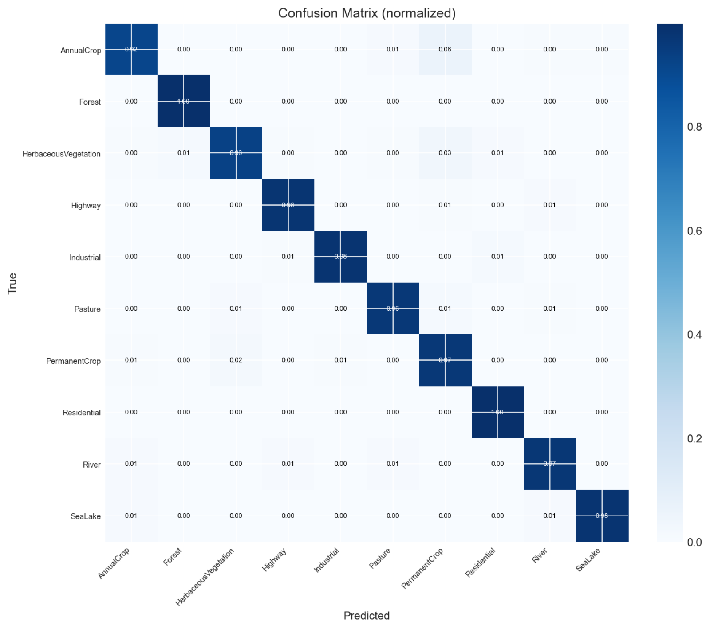
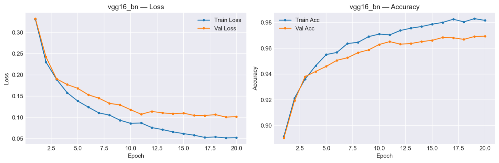
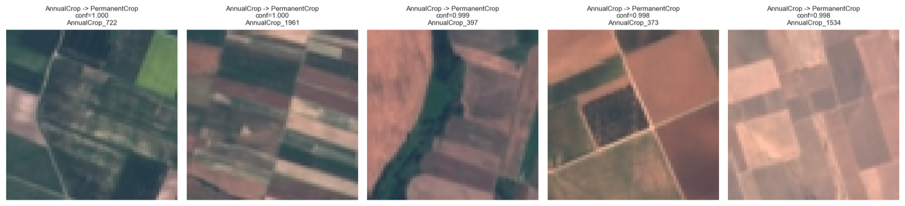
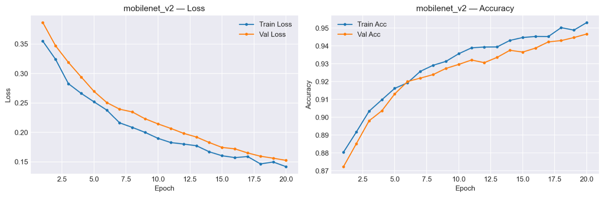
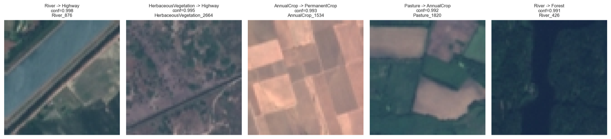

Arazi kullanımı ve arazi örtüsü sınıflandırması bir uzaktan algılama problemi. Tarım, şehir planlama, çevre izleme ve afet müdahalesi için önemli. Bu projede, RGB EuroSAT veri setindeki Sentinel-2 görüntü parçalarını ormanlardan nehirlere, otoyollardan yerleşim alanlarına kadar on sınıfa ayıran CNN'leri eğittim ve değerlendirdim.

Çalışmaya Google Colab'de bir notebook ile başladım, sonra yeniden kullanılabilir script'lere dönüştürdüm. Nihai modelleri kiralık bir NVIDIA RTX 6000 sınıfı GPU üzerinde eğittim.

## Veri seti

EuroSAT RGB, on sınıfa dağılmış 64 × 64 piksellik 27.000 görüntü parçasından oluşuyor. Veriyi sabit bir seed ile 70/15/15 oranında tabakalı eğitim, doğrulama ve test kümelerine ayırdım. Test kümesinde 4.050 görüntü kalıyor.

Her sınıftan rastgele örnekler:

Sınıflar arasında hafif bir dengesizlik var. Her sınıfta 2.000 ile 3.000 arası görüntü bulunduğu için eğitimde sınıf ağırlıklı kayıp kullanılıyor.

## Yöntem

İki backbone da torchvision'daki ImageNet ön eğitimli ağırlıklarla başlıyor. Her birine on EuroSAT sınıfı için yeni bir sınıflandırıcı katmanı ekleniyor ve eğitim iki aşamada ilerliyor:

1. **Dondurulmuş backbone:** yalnızca yeni katman, 1e-3 öğrenme oranıyla 10 epoch eğitiliyor.
2. **Fine-tuning:** ağın tamamı çözülüyor ve ilk aşamanın en iyi ağırlıklarından devam edilerek 1e-5 öğrenme oranıyla 20 epoch eğitiliyor.

Görüntüler 224 × 224 boyutuna getiriliyor. Eğitimde yatay çevirme, rastgele döndürme ve renk oynamaları kullanılıyor. Eğitim ayrıca AdamW optimizer'ı, sınıf ağırlıklı cross-entropy, ReduceLROnPlateau, doğrulama kaybına göre erken durdurma, CUDA'da karma hassasiyet ve checkpoint'ten devam etme özelliklerini kullanıyor.

## Sonuçlar

Değerlendirme, ayrılmış 4.050 görüntülük test kümesinde yapıldı.

| Model | Doğruluk | Makro F1 | Makro AUC | ms / görüntü | Parametre |
|---|---:|---:|---:|---:|---:|
| VGG16-BN | %96,69 | 0,9665 | 0,9993 | 139,74 | 134,3M |
| MobileNetV2 | %95,26 | 0,9511 | 0,9986 | 27,97 | 2,9M |

En yüksek doğruluk VGG16-BN'de. MobileNetV2 ise yalnızca 1,4 puan geride kalıyor, buna karşın yaklaşık 46 kat daha küçük ve 5 kat daha hızlı. Bu yüzden gecikme veya bellek önemli olduğunda daha pratik bir seçim.

### VGG16-BN

En yüksek güvenle yapılan yanlış tahminler hata analizi için faydalı. VGG16-BN'de bunların beşi de kalıcı ürün olarak tahmin edilen yıllık ürün alanları. Bu iki sınıf yukarıdan neredeyse aynı görünebiliyor.

### MobileNetV2

## Teknolojiler

Python, PyTorch, torchvision, scikit-learn, pandas, NumPy, Matplotlib, seaborn, Google Colab.

## Bağlantılar

- [GitHub'daki kaynak kodu](https://github.com/AhmetServet/eurosat-cnn)
